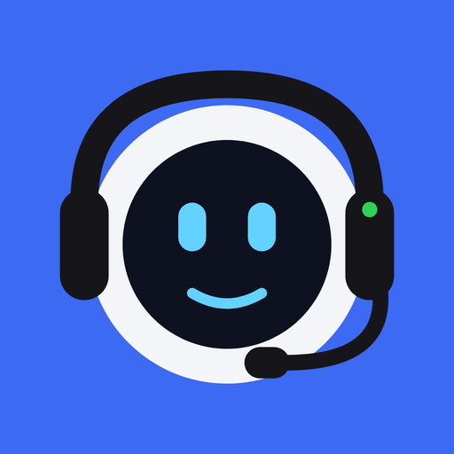
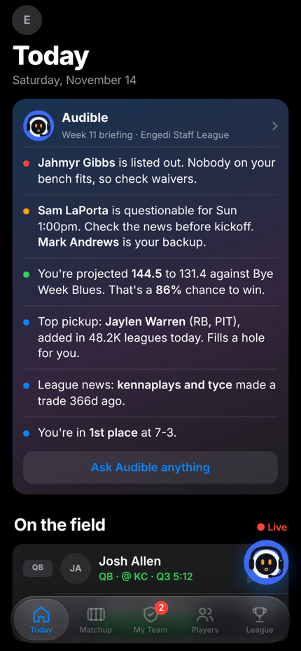
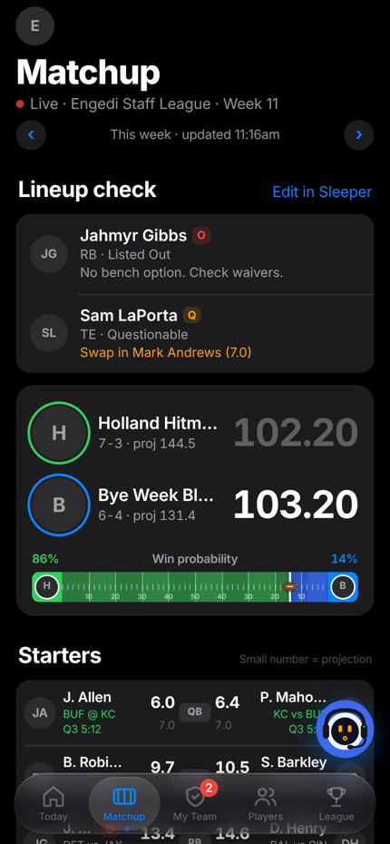
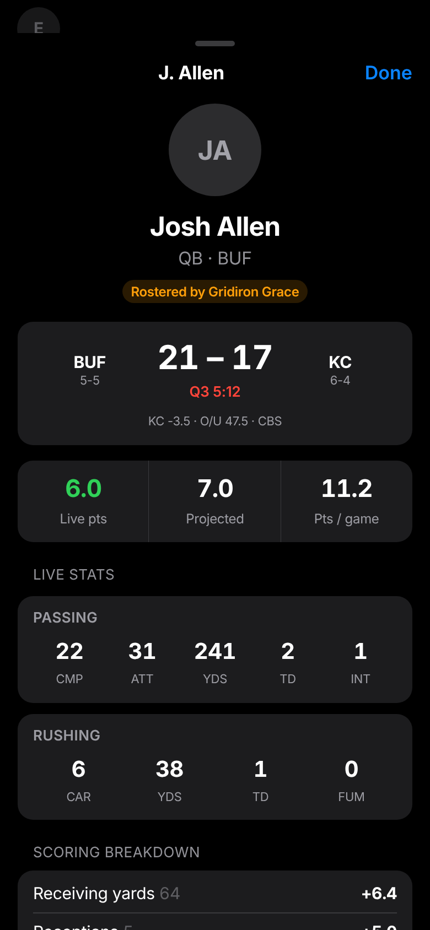
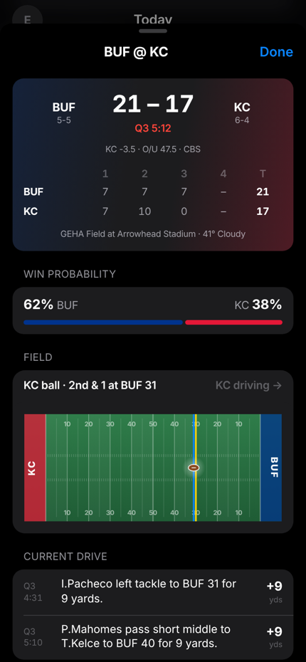
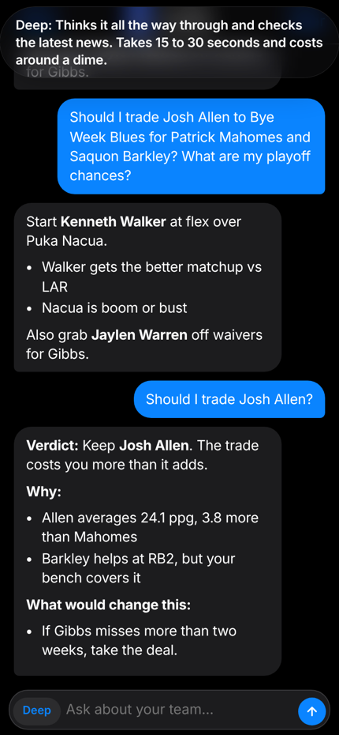

# Audible

**Fantasy football, from the sideline.**

A simpler way to follow your Sleeper team. Live matchups, your lineup, waivers, league activity and NFL news in one fast app that feels at home on your iPhone, with a coach named Audible in the corner of every screen.

### [Open Audible →](https://evanthebruce12.github.io/audible/)

Free · No account · Nothing to download

---

## Install it on your iPhone

1. Open [evanthebruce12.github.io/audible](https://evanthebruce12.github.io/audible/) in **Safari**
2. Tap the **Share** button, then **Add to Home Screen**
3. Open it from your Home Screen and type your **Sleeper username**

That's it. No password, no account to make. Adding it to your Home Screen is what makes it look and act like a real app, and it's also the only way iPhone allows notifications.

## What it does

<table>
<tr>
<td width="20%"></td>
<td width="20%"></td>
<td width="20%"></td>
<td width="20%"></td>
<td width="20%"></td>
</tr>
<tr>
<td align="center"><b>Today</b></td>
<td align="center"><b>Matchup</b></td>
<td align="center"><b>Players</b></td>
<td align="center"><b>Games</b></td>
<td align="center"><b>Audible AI</b></td>
</tr>
</table>

**A daily briefing.** Audible checks your lineup, your matchup, the waiver wire and the standings, and puts what matters on one card.

**Live matchups.** Scores and projections update on their own. Win probability plays out on a little football field: your territory is green, your opponent's is blue.

**Deep player cards.** Tap any player for Audible's take, his position rank, whether he's hot or cold, full season stats, a game log, recent news, and his depth chart spot.

**Every NFL game.** A live field with the ball on it, play-by-play replays, score by quarter, win odds, game leaders and a side-by-side team stat comparison.

**Alerts that matter.** Lineup problems, a Saturday night check, lead changes, close games, finals, waiver results, trades and a Tuesday briefing. Quiet from 10pm to 8am, except during live games.

**Your whole league.** Standings, scores, every roster, and the recent waiver and trade activity.

## Free, with an optional AI coach

Everything above is free and always will be. The one part that costs anything is **chatting with Audible**, because that runs on Claude.

To turn it on, add your own Claude API key in the app under **Audible AI**. The app walks you through it in four steps. You pay Anthropic directly for what you use, usually a few dollars a month or less, and there's a built-in spending tracker and monthly limit so you're never surprised. A Claude Pro or Max subscription does **not** include API access; it's a separate pay-as-you-go account at [console.anthropic.com](https://console.anthropic.com).

You can pick how hard Audible thinks: **Auto**, **Quick**, **Balanced**, or **Deep**, which reasons all the way through a question and checks the latest news before answering. You can also set how long his answers run.

Your key is stored only on your phone, and in your own encrypted backup if you turn that on.

## Good to know

**Audible can't change your team.** Sleeper only lets other apps read league data, so Audible tells you what to do and the buttons take you into Sleeper to actually do it. Nothing can be changed by accident.

**Your data stays yours.** Your league info, settings and chats live on your phone. Nothing is collected or shared.

**Settings backup.** Set a PIN under Settings → Backup and your settings, chats and key are saved encrypted. Sign in with the same Sleeper username on a new phone and enter the PIN to get everything back.

## How it's built

One self-contained HTML file, no build step and no framework. Data comes from the public Sleeper API and ESPN's public scores and news. Notifications run through a small [Cloudflare Worker](worker/) using Web Push.

| | |
|---|---|
| **App** | `index.html` · plus `manifest.json`, `sw.js`, icons |
| **Watcher** | `worker/worker.js` · Cloudflare Worker (notifications, encrypted backups) |
| **Changes** | [CHANGELOG.md](CHANGELOG.md) |

## Credits

Built by Evan Aulick. Not affiliated with Sleeper, ESPN, the NFL or Anthropic.
